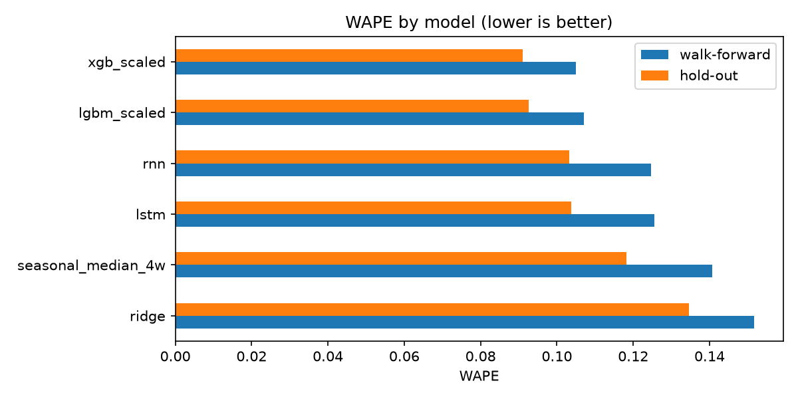
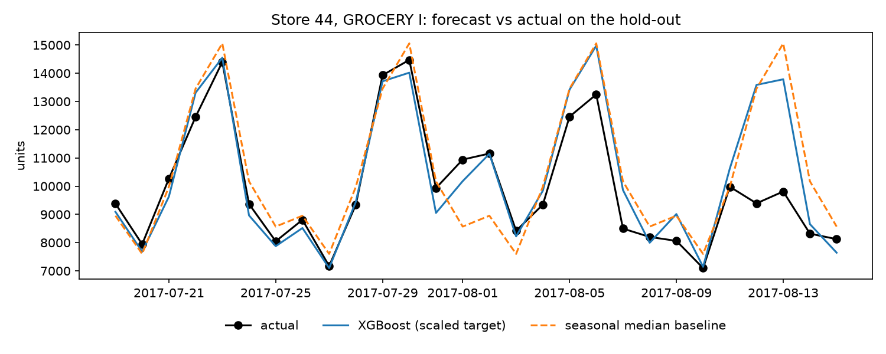
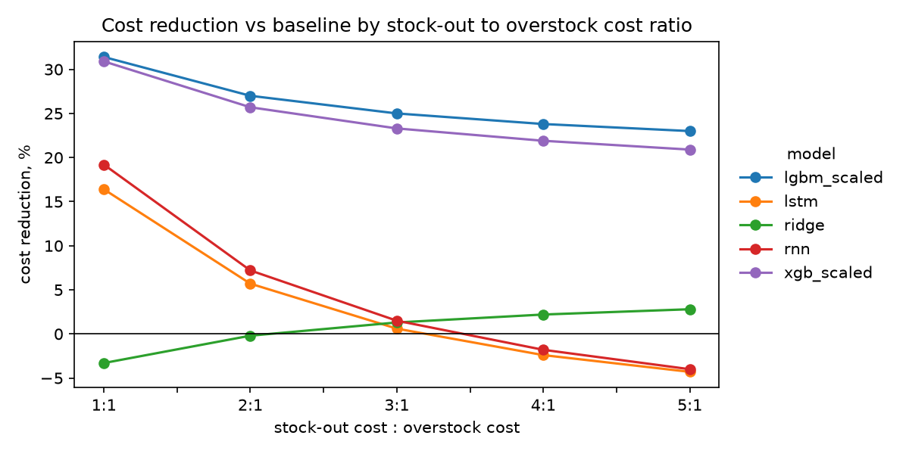

# Demand Forecasting

28-day demand forecast for 25 store and product-family series of an Ecuadorian grocery chain (Favorita). XGBoost with the target divided by the series level lowers WAPE from 0.141 (seasonal median baseline) to 0.105 in walk-forward validation, and from 0.118 to 0.091 on a hold-out that was used once. Under an assumed stock-out to overstock cost of 3:1, weekly orders based on it cost 23% less on walk-forward and 13% less on the hold-out. RNN and LSTM are not convincingly better than the baseline and need about 50 times more training time.

## Business problem

- **Who has the problem:** a replenishment planner of a supermarket chain.
- **Why it matters:** stock-outs lose sales, overstock ties up money and spoils (food, produce).
- **Decision the model supports:** how much to order for each store and product family for the next 28 days.
- **Cost assumptions:** the data has no prices or margins, so costs are counted in units: a missing unit costs 3, an extra unit costs 1. The ratio is varied from 1:1 to 5:1 in a sensitivity analysis.

## Data

- **Source:** [Favorita Store Sales](https://www.kaggle.com/competitions/store-sales-time-series-forecasting/data) (Kaggle). Used for education and the portfolio only, the data is not redistributed; see [data/README.md](data/README.md).
- **Subset:** 5 stores (44, 3, 51, 11, 24; types A, B, D; Quito, Guayaquil, Cayambe) x 5 families (GROCERY I, BEVERAGES, PRODUCE, CLEANING, DAIRY) = 25 series, 2015-08-16 to 2017-08-15 (731 days). These families are dense (about 2% of zero days) unlike sparse ones such as BOOKS.
- **Target:** daily `sales` per store and family.
- **Data issues handled:** Dec 25 is missing (filled), Dec 25 and Jan 1 are closed days (marked and excluded from training and metrics), the April 2016 earthquake and other outliers are real events and are kept, `transactions` is not known in the future and is not used as a feature.

## Approach

- **Validation:** 8 walk-forward folds of 28 days with an expanding train window, no random split. The last 28 days (2017-07-19 to 2017-08-15) are a hold-out, evaluated once at the end.
- **Features:** sales lags (28, 35, 42, 56 days) and rolling mean and std shifted by 28 days, so every feature is known at forecast time; calendar, holiday and event flags, promotions. A leakage test confirms that changing sales after a date does not change features of the next 28 days.
- **Models:** seasonal baselines (the strongest is the median of the last 4 weeks per weekday), Ridge, XGBoost and LightGBM (target divided by the series level), RNN and LSTM (window of 56 days, 28 outputs, series embedding, early stopping, 3 seeds).
- **Metrics:** MAE, RMSE and WAPE (sum of absolute errors divided by sum of sales). WAPE is comparable across series of different scale and safe with zeros, unlike MAPE.
- **Significance:** paired bootstrap over (fold, series) units and a Wilcoxon test over folds.
- **Business simulation:** each forecast becomes weekly orders per series; cost = 3 x missing units + 1 x extra units.

## Results

Mean over the 8 walk-forward folds (MAE and RMSE in units per day) and WAPE on the hold-out:

| Model | MAE | RMSE | WAPE | WAPE on hold-out |
| --- | --- | --- | --- | --- |
| XGBoost, scaled target | 517.3 | 883.6 | 0.105 | 0.091 |
| LightGBM, scaled target | 527.9 | 889.9 | 0.107 | 0.093 |
| RNN | 611.1 | 1058.3 | 0.125 | 0.103 |
| LSTM | 616.6 | 1030.9 | 0.125 | 0.104 |
| Seasonal median baseline | 695.4 | 1193.7 | 0.141 | 0.118 |
| Ridge | 746.6 | 1140.5 | 0.152 | 0.135 |



- XGBoost and LightGBM are better than the baseline in 8 of 8 folds (Wilcoxon p 0.004, bootstrap intervals above zero). No model is better than XGBoost; LightGBM is practically tied.
- RNN (6 of 8 folds, p 0.07) and LSTM (3 of 8, p 0.47) are not convincingly better than the baseline. Ridge is significantly worse.
- The oil price lag was a trending proxy for time and hurt validation: removing it lowered WAPE from 0.126 to 0.112 and fixed the weakest fold.
- Hyperparameter search (18 combinations) gave less than 1%, so the defaults are kept.



**Business effect (simulated).** With a 3:1 cost ratio and weekly orders, XGBoost lowers the cost by 23% against the baseline on walk-forward (LightGBM 25%) and by 13% on the hold-out, and raises the share of covered demand from 94.7% to 95.6%.



For ratios from 1:1 to 5:1 the boosters stay 21-31% cheaper than the baseline. The networks beat the baseline only when stock-outs are cheap. A fixed safety factor tuned on walk-forward (orders 7.5% above the forecast) raised the cost on the calm hold-out, so it is not recommended.

## Limitations

- Costs are assumed units: there are no prices, margins, lead times, shelf life or capacity in the data, and weekly netting assumes stock carries over inside a week.
- Only two years of data (two Decembers), so holiday effects are learned from few examples. The hold-out is one 28-day window (700 rows) and it was an easier month than the average fold.
- Features, scaling and hyperparameters were chosen on the same walk-forward folds, so the improvement may be slightly optimistic. The bootstrap ignores the correlation between consecutive folds, so its intervals are narrow.
- The networks were not tuned (window, hidden size, dropout) and the early stopping set is small and noisy.
- The result holds for 25 dense series of one retailer and may differ for sparse items.

## Takeaway

XGBoost with the target divided by the series level won: trees learn the interaction of weekday, store and family and handle missing values, and the scaling lets them learn the shape of the demand instead of the scale of each series. The networks cost about 50 times more training time for a worse result. Next steps: quantile forecasts (for example the 75th percentile) for the asymmetric costs, more history, planned promotions as future information, hierarchical forecasts and a retraining schedule.

## How to run

Requirements: Python 3.13, [uv](https://docs.astral.sh/uv/), Docker and a Kaggle account.

1. Install dependencies:

```bash
uv sync
```

2. Download the data from the link above (accept the competition rules), unzip it into `data/raw/` and delete `test.csv` and `sample_submission.csv`.
3. Create `.env` from `.env.example` and set a password:

```bash
cp .env.example .env
```

4. Start PostgreSQL and build the tables and views:

```bash
docker compose up -d
docker compose exec db psql -U demand -d demand -f /sql/01_schema.sql
docker compose exec db psql -U demand -d demand -f /sql/02_load.sql
docker compose exec db psql -U demand -d demand -f /sql/03_subset.sql
docker compose exec db psql -U demand -d demand -f /sql/04_holidays.sql
```

5. Run the notebooks in order:

```bash
uv run jupyter lab
```

`07_comparison` takes about 17 minutes (it trains the networks on 9 folds) and writes the predictions to `data/processed/`. `05_models` and `06_lstm` save the final models to `models/`.

**Reproducibility.** All random seeds come from `SEED` in `src/demand/config.py` (XGBoost, LightGBM, PyTorch, bootstrap). The extra seeds 1 and 2 for RNN and LSTM are set explicitly in `06_lstm`. Results matched to the third decimal between runs on the same machine; with a different number of CPU threads small differences are possible.

## Project structure

```
data/
  README.md        # data description (tracked)
  raw/             # Kaggle files (ignored)
  processed/       # subset and predictions (ignored)
docs/              # project brief, experiment log, work plan, git workflow
models/            # saved final models (ignored)
notebooks/
  01_data_exploration   # subset selection
  02_eda                # trend, seasonality, holidays, gaps, outliers
  03_baseline           # naive and seasonal baselines
  04_features           # features and leakage check
  05_models             # Ridge, XGBoost, LightGBM, ablation, tuning
  06_lstm               # RNN and LSTM
  07_comparison         # predictions of all models on the same folds
  08_evaluation         # metrics, significance tests, hold-out
  09_business           # cost simulation and sensitivity
reports/figures/   # figures used in this README
sql/               # schema, loading, subset and holiday views
src/demand/        # config, data, features, metrics, models, nets, validation, simulation
```

More details: [project brief](docs/01_Project_Brief.md), [experiment log](docs/02_Experiment_Log.md), [work plan](docs/03_Work_Plan.md), [git workflow](docs/04_Git_Workflow.md).
